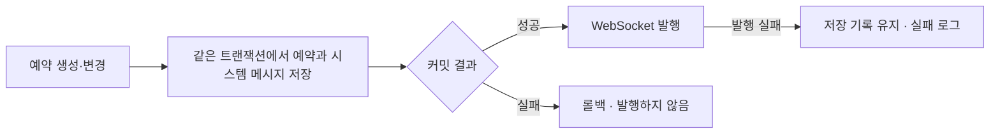

# 예약 기록과 메시지의 일관성

[← 전체 사례](../README.md)

**프로젝트:** 네일샵 점주와 고객의 상담·예약 서비스 SnapBook

**맡은 범위:** 예약 정보 모델링, 예약 변경의 시스템 메시지 연결, 저장과 발행의 트랜잭션 경계

## 문제와 판단

메뉴는 점주가 계속 수정하는 설정이고, 예약은 고객과 합의한 개별 기록입니다. 예약을 조회할 때 현재 메뉴의 이름·가격을 그대로 읽으면 설정 변경이 과거 예약에 소급됩니다. 메뉴명·가격은 예약 메뉴 항목에 복사하고, 확정한 소요시간은 예약 자체에 저장했습니다. 예약을 명시적으로 변경하는 경로와 매장 설정을 바꾸는 경로를 구분한 것입니다.

예약 상태는 상담 화면의 시스템 메시지로도 표시됩니다. 예약 저장은 성공했지만 메시지 저장이 실패하면 상담 기록과 예약 상태가 어긋납니다. 반대로 DB 커밋 전에 발행하면 나중에 롤백되는 예약이 화면에 먼저 보일 수 있습니다.

## 구현

- `ReservationMenuItem`에 메뉴명·가격 스냅샷을, `Reservation`에 소요시간을 저장했습니다.
- 예약 이벤트의 메시지 저장 리스너는 `Propagation.MANDATORY`로 기존 트랜잭션에 참여합니다.
- 별도 발행 리스너가 `AFTER_COMMIT`에 메시지를 전송합니다. 발행 실패가 이미 확정된 예약과 메시지를 취소하지 않도록 했습니다.

커밋 이후 발행은 DB 롤백과 화면 반영의 순서를 정합니다. 커밋 직후 프로세스가 종료되는 구간까지 자동 재전송을 보장하는 구조는 아닙니다. 실시간 발행이 실패해도 저장된 메시지는 이력 조회의 근거로 남습니다.

## 검증 조건

통합 테스트의 확인 조건은 다음과 같습니다.

| 조건 | 테스트의 확인 내용 |
| --- | --- |
| 예약·시스템 메시지 저장 | 저장된 예약과 연결되는 메시지를 발행 |
| 시스템 메시지 저장 중 예외 | 예약도 롤백하고 발행하지 않음 |
| WebSocket 발행 중 예외 | 예약과 시스템 메시지는 DB에 유지 |
| 메시지 이력 재조회 | 시스템 메시지와 발신자 정보 유지 |
