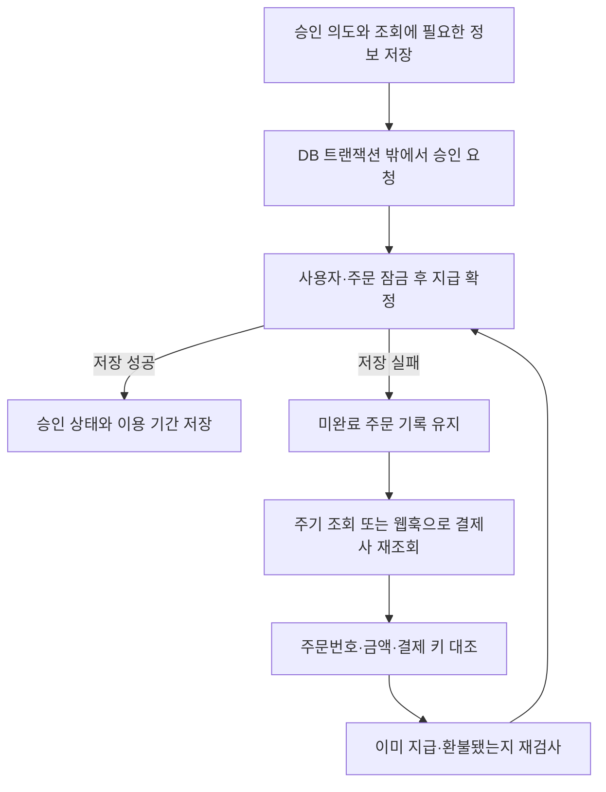

# 결제 승인 복구와 주문별 이용 기간 보존

[← 전체 사례](../README.md)

**프로젝트:** 한능검 유료 학습 서비스

**맡은 범위:** Toss 승인 후 저장 실패 복구, 지급·환불 상태 보호, 운영 조회 오류 진단과 분류

## 문제와 판단

결제사의 승인은 성공했지만 내부 DB 저장에 실패하면 고객은 결제하고도 이용권을 받지 못합니다. 외부 API 호출과 내부 트랜잭션은 함께 롤백할 수 없으므로, 승인 요청 사실을 먼저 남기고 외부 결과를 다시 확인할 경로가 필요했습니다.

네트워크 응답을 기다리는 동안 사용자·주문 행 잠금을 유지하지 않도록 승인 요청 기록, 외부 호출, 지급 확정을 분리했습니다. 대신 마지막 지급 단계에서 주문 상태를 잠금 아래 다시 검사합니다.

## 처리 흐름

지급이 끝난 주문은 기존 이용권을 반환하고, 환불된 주문은 늦은 승인 결과로 복원하지 않습니다. 반복 조회가 이용 기간을 늘리지 않도록 동일 주문의 지급 결과를 보존했습니다.

## 환불할 주문과 남겨야 할 구매 구분

환불을 계정 단위로 처리하면 다른 주문으로 구매한 기간까지 사라질 수 있습니다. 예를 들어 3일권과 하루 연장을 구매한 고객이 3일권만 환불하면, 별도로 구매한 하루는 보존해야 합니다.

주문별 이용 시작·종료 시각과 지급 기간을 기록하고, 환불 주문의 미사용 기간만 제거하도록 했습니다. 남은 주문의 이용 기간을 다시 배치하되 이미 사용한 시간을 복원하거나 겹치는 기간을 이중 합산하지 않도록 했습니다.

| 상황 | 유지할 결과 |
| --- | --- |
| 3일권과 1일 연장 구매 후, 미사용 3일권 환불 | 미환불 하루 연장 보존 |
| 같은 환불 통보 반복 | 최초 회수 결과 유지·기간 추가 없음 |
| 이용 기간이 겹치는 다른 구매 존재 | 겹치는 기간을 중복 합산하지 않음 |
| 환불 뒤 늦은 승인 결과 도착 | 환불 주문 재지급 차단 |

## 운영에서 확인한 조회 오류

운영 컨테이너에서 같은 인증 조건으로 조회했을 때 주문번호 경로는 404, 결제 키 경로는 200을 반환했습니다. 내부에 결제 키가 있으면 그 경로를 우선하도록 수정했습니다. 이후 승인 요청 없이 결제창을 닫은 주문의 통보에서도 404가 발생해, 오류 코드와 주문의 처리 이력을 함께 판단했습니다.

| 조회 결과와 내부 상태 | 처리 기준 |
| --- | --- |
| 주문이 생성 상태이고 승인 요청 이력이 없으며 조회가 404 | 상태를 바꾸지 않고 통보 처리 종료 |
| 승인 요청 이력이 있는데 조회가 404 | 결과 미확정 오류로 남겨 재전송·복구 대상 유지 |
| 결제사 재조회 결과가 승인 완료이며 내부 주문과 일치 | 잠금 아래 지급 여부 확인 후 누락된 지급 처리 |
| 다른 주문번호·금액·기존 결제 키와 불일치 | 반영 거절 |
| 이미 환불된 주문에 늦은 승인 통보 | 이용권을 다시 지급하지 않음 |

웹훅의 결제 키는 **조회 힌트**로만 사용합니다. 실제 반영의 근거는 서버 인증으로 다시 조회한 결제 결과와 내부 주문의 일치 여부입니다.

## 검증 결과와 범위

- **승인 후 저장 실패:** DB 제약조건으로 승인 상태 저장을 실패시켰습니다. 승인 의도는 남고 이용권은 없는 상태에서 제약을 해제한 뒤 재조회해 이용권을 복구하고, 반복 조회 후에도 이용 기간이 같음을 확인했습니다.
- **환불:** 기본 이용권 환불 후 미환불 연장만 남는 조건, 반복 통보가 기간을 늘리지 않는 조건을 검사했습니다.
- **오류 분류:** 승인 요청 없는 404, 승인 요청 있는 404, 웹훅 키로 조회한 승인, 다른 주문 키의 거절을 픽스처에 추가했습니다.

PR #693에는 별도 PostgreSQL 16과 결제사 모의 응답으로 결제 복구·환불 3개 테스트가 통과한 기록이 있습니다. #750의 추가 오류 분류 검증은 PGlite 픽스처입니다. 운영 조회 경로의 404/200 대조는 #714에 기록되어 있습니다. 자동 테스트 결과를 실제 결제사의 모든 장애에 대한 복구 보장으로 해석하지 않습니다.

## 근거

원본은 비공개 저장소이며 접근 권한이 필요합니다. 설명은 해당 PR의 본문과 코드·테스트 변경을 바탕으로 정리했습니다.

- [#693 승인 의도 선저장과 지급 복구](https://github.com/pukyongpuk/mvp1.0/pull/693): 결제 저장 로직, 복구 실행기, 저장 실패·환불 픽스처
- [#714 운영 조회 경로 진단](https://github.com/pukyongpuk/mvp1.0/pull/714): 결제 키 우선 조회와 응답 주문번호 대조
- [#750 승인 요청 여부에 따른 404 분류](https://github.com/pukyongpuk/mvp1.0/pull/750): 조회 오류 형식, 웹훅 힌트, 세 가지 추가 픽스처
