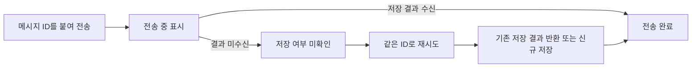

# 메시지 저장 결과와 화면의 전송 상태 일치

[← 전체 사례](../README.md)

**프로젝트:** 예약 내역을 시스템 메시지로 제공하는 상담·예약 서비스 SnapBook

**맡은 범위:** 중단 시점별 전송 문제 재현, 저장 결과 기반 완료 기준, 동일 ID 재시도와 이력 복구

## 문제와 판단

클라이언트가 메시지를 보내자마자 전송 완료처럼 표시하면, 서버 종료 시 화면과 실제 저장 결과가 달라질 수 있습니다. 저장 전 중단은 메시지 유실로 이어지고, 저장 후 결과 전달 전 중단은 성공 여부를 알 수 없어 중복 재시도로 이어질 수 있습니다.

Graceful Shutdown은 서버가 이미 처리 중인 요청을 마칠 시간을 주지만, 서버에 도착하지 않은 메시지까지 보호하지는 못합니다. 따라서 종료 절차만 조정하는 것으로는 부족하다고 판단했고, 완료 판단의 근거를 서버의 저장 결과로 정했습니다.

## 완료와 재시도의 규칙

결과를 받지 못했다는 사실만으로 DB 저장 실패를 단정하지 않습니다. 화면에는 완료로 확정하지 않은 상태를 남기고, 같은 ID로 다시 보내거나 재접속 후 이력을 조회해 확인합니다.

서버는 채팅방 잠금 아래에서 채팅방·발신자·클라이언트 메시지 ID로 기존 메시지를 찾습니다. 동일한 요청이면 기존 결과를 반환하고, 같은 ID로 내용을 바꾼 요청은 거절합니다. 다른 ID의 새 메시지는 내용이 같아도 별개의 전송으로 저장합니다.

클라이언트는 서버 결과의 메시지 ID와 클라이언트 메시지 ID를 이용해 임시 표시를 확정 메시지로 교체합니다. 재연결 후에는 저장된 메시지 이력을 조회해 화면을 복구합니다.

## 중단 시점별 검증 결과

격리된 로컬 Docker에서 Java 17·MySQL 8.4·WebSocket/STOMP를 사용했습니다. 기존 ID 없는 클라이언트와 개선한 ID 기반 클라이언트를 비교했으며, 각 시점에서 3회씩 중단한 뒤 수동 재시도를 모의하고 재접속 후 이력을 조회했습니다.

| 중단 시점 | 확인할 위험 | 개선 후 재시도·복구 결과 |
| --- | --- | --- |
| 서버에 메시지가 도착하기 전 | 저장하지 않은 메시지가 전송 완료처럼 표시됨 | 3회 모두 DB 1건·발신자 화면 1건 |
| DB 커밋 전 | 롤백된 메시지가 화면에만 남음 | 3회 모두 DB 1건·발신자 화면 1건 |
| DB 커밋 후 결과 수신 전 | 저장된 메시지를 재시도해 중복 저장함 | 3회 모두 DB 1건·발신자 화면 1건 |

결과 기록에서 기존 방식은 9회 중 저장되지 않은 메시지의 경고 없는 표시가 6회, 중복 저장이 3회 발생했습니다. 개선 후 9회에서는 두 항목 모두 0회였습니다. 이 결과는 해당 중단·재시도 조건의 검증이며 모든 장애 상황에 대한 보장을 뜻하지 않습니다.

## 구현·검증 범위

이 사례는 별도 개선 구현과 격리 환경 시험을 다룹니다. 확인한 공개 백엔드 기본 브랜치 커밋에는 동일 ID 재시도 구현이 포함되어 있지 않으므로, 운영 배포 완료와 구분합니다. 기존 [예약·시스템 메시지의 커밋 후 발행](01-reservation-consistency.md)은 공개 백엔드 코드로 별도 확인할 수 있습니다.
